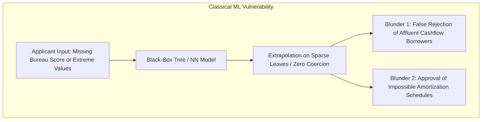
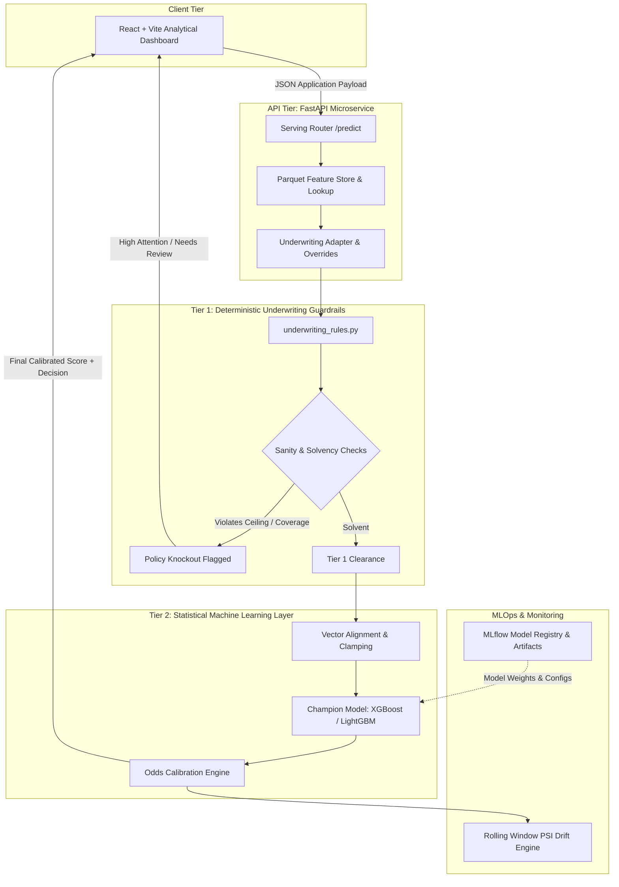

# LendingClub Underwriting Intelligence & Credit Default Risk Scoring
## Comprehensive Technical Documentation & Academic Project Review 1

---

## Executive Summary

Traditional consumer credit assessment systems rely almost exclusively on credit bureau scores (e.g., FICO in the United States, CIBIL/Experian in India). While bureau scores provide a historical snapshot of prior debt repayment, they introduce critical systemic failure modes:
1. **Financial Exclusion of Thin-File Borrowers**: Credit-invisible, young, or unbanked individuals are rejected outright or penalized with usurious interest rates simply due to an absence of credit history, rather than demonstrable insolvency.
2. **Subprime Fallacies & Ghost Defaults**: Naive machine learning implementations treat missing bureau scores as mathematical zeros or deep subprime outliers, predicting massive default rates (e.g., >40%) for affluent individuals with zero collateral requirement.
3. **Out-of-Distribution & Financial Nonsense Blunders**: Standard machine learning models (unconstrained tree ensembles and neural networks) are non-causal function approximators. Without policy guardrails, they generate catastrophic underwriting blunders—such as approving a $120,000 personal loan with an unpayable $390/month payment as "Low Risk" (12.9%).

This project designs, engineers, and validates an end-to-end, **Production-Grade Underwriting Intelligence System** trained on **1.28 million real-world peer-to-peer loans from LendingClub**. The platform bridges **Statistical Machine Learning** (XGBoost, LightGBM, MLP, Entity Embeddings, TabTransformer) with **Deterministic Tier-1 Underwriting Policy Guardrails & Cashflow Solvency Analysis**.

The system enables **Alternative, Collateral-Free Underwriting** for thin-file applicants, dynamically calculates amortized debt obligations, provides real-time population stability drift tracking, and deploys via an enterprise **FastAPI microservice** coupled with an interactive **React + Vite analytical dashboard**.

---

## 1. Problem Formulation & Academic Motivation

### 1.1 The Collateral Paradox in Consumer Credit
In traditional retail banking, unsecured personal loans present the highest risk of default because the lender holds no secondary recourse (such as real estate, gold, or vehicles) to liquidate upon borrower delinquency. Consequently, legacy risk underwriting heavily over-indexes on bureau track records:
- **Bureau Scores (FICO/CIBIL)** are backward-looking lagging indicators. They measure *past behavior* across existing debt lines rather than *forward-looking cashflow liquidity*.
- **The Catch-22**: To obtain an unsecured loan, a borrower needs a good credit score; to build a credit score, the borrower must have previously taken on and serviced credit accounts.

### 1.2 The Failure Modes of Pure-ML Underwriting
When machine learning is applied to credit scoring without domain-specific guardrails, two catastrophic phenomena occur:



1. **Missing Bureau Penalty**:
   If an applicant does not have a credit score, standard software serialization often translates `null` or empty strings `""` to `0`. The model calculates an average FICO of `0.0`. Because valid FICO scores strictly occupy the range $[300, 850]$, a zero is interpreted as worse than severe bankruptcy, yielding a high predicted default rate (>40%) despite high disposable earnings.
2. **Out-of-Distribution (OOD) Pathologies**:
   Decision trees perform orthogonal partitions of feature space. For values well outside institutional caps (e.g., requesting $120,000 when the platform limit is $40,000), trees predict the leaf value of the closest historical partition, often yielding artificially low risk probabilities because the training set contained no $120,000 personal loans.
3. **Ghost Amortization & Negative Coverage**:
   Unscrupulous or erroneous applicants may submit an impossible combination: a $120,000 loan over 36 months with a stated $390/month installment. Over 3 years, $390 $\times$ 36 = $14,040, which only recovers **11.7% of the original principal**, representing an instantaneous 88% loss to the lender before interest. Pure statistical ML models unaware of basic financial arithmetic can classify this as "Low Risk" simply because the low installment creates an artificially low installment-to-income ratio.

---

## 2. Target Beneficiaries & Industry Context

| Stakeholder | Legacy Pain Point | System Solution |
| :--- | :--- | :--- |
| **Thin-File / Young Borrowers** | Inability to access credit without historical loans or collateral. | **Cashflow-First Assessment**: Allows bureau score fields to be optional. Calculates capacity to repay via Disposable Monthly Cashflow, Repayment Coverage, and Debt-to-Income (DTI). |
| **Fintech Underwriters & Risk Officers** | Black-box ML models producing unexplainable, embarrassing approvals/rejections. | **Two-Tier Architecture**: Hard policy guardrails automatically knockout invalid, predatory, or unamortizable loans before ML inference runs. |
| **Financial Regulators (FCRA, CFPB, RBI)** | Algorithmic bias and lack of compliance transparency. | Explicit, auditable reason codes for rejections; bounded input ranges; dynamic probability calibration. |
| **MLOps & Engineering Teams** | Silent model performance degradation due to macro-economic regime shifts. | Real-time **Population Stability Index (PSI)** calculation against reference training baselines with rolling-window drift alerts. |

---

## 3. Mathematical Foundations & Underwriting Rationale

### 3.1 Financial Sanity & Solvency Formulations

#### A. Standard Amortization Installment Formula
For a principal loan amount $P$, an annualized interest rate $r$ (institutional benchmark benchmarked at 11.5% APR), and loan term $n$ months, the monthly rate is $i = \frac{r}{12}$. The mathematically required monthly payment is:

$$M = P \times \frac{i(1 + i)^n}{(1 + i)^n - 1}$$

If an applicant inputs a user-specified installment $M_{\text{user}}$, the system calculates the **Repayment Coverage Ratio ($RCR$)**:

$$RCR = \frac{M_{\text{user}} \times n}{P}$$

- If $RCR < 1.0$, the scheduled payments do not even recover the principal. The application triggers an immediate `IMPOSSIBLE_AMORTIZATION` policy knockout.

#### B. Monthly Cashflow & Debt Burden Metrics
Given gross annual income $I_{\text{annual}}$ and Debt-to-Income percentage $DTI$:

$$\text{Gross Monthly Income } (GMI) = \frac{I_{\text{annual}}}{12}$$

$$\text{Existing Monthly Debt Service } (EDS) = GMI \times \left(\frac{DTI}{100}\right)$$

$$\text{Disposable Monthly Cashflow } (DMC) = GMI - EDS - M$$

$$\text{Debt Service Burden } (DSB) = \frac{M \times 12}{I_{\text{annual}}} \times 100$$

$$\text{Salary Multiplier } (SM) = \frac{P}{I_{\text{annual}}}$$

Policy knockouts are triggered deterministically when:
- $DMC < 0$ (Applicant is operationally insolvent on day one).
- $DSB > 40.0\%$ (This single loan consumes more than 40% of gross earnings).
- $P > \$40,000$ (Exceeds institutional borrowing ceiling).

### 3.2 Probability Calibration: Unbiasing Class Imbalance
In credit risk datasets, defaults represent a minority class ($\approx 20\%$). Models trained with class-weighting (e.g., `scale_pos_weight = 4.0` to penalize missed defaults) intentionally distort the raw output probabilities. 

To restore true posterior default probabilities $P(Y=1|X)$, the raw odds ratio is mathematically unweighted via:

$$\text{Odds}_{\text{raw}} = \frac{p_{\text{raw}}}{1 - p_{\text{raw}}}$$

$$\text{Odds}_{\text{calibrated}} = \frac{\text{Odds}_{\text{raw}}}{w} \quad \text{where } w = \text{scale\_pos\_weight}$$

$$p_{\text{calibrated}} = \frac{\text{Odds}_{\text{calibrated}}}{1 + \text{Odds}_{\text{calibrated}}}$$

### 3.3 Data Drift Detection via Population Stability Index (PSI)
To identify when incoming production inferences diverge from the LendingClub training population, continuous features are binned into deciles $B_1, \dots, B_{10}$. For reference distribution $R$ and production inference distribution $A$:

$$PSI = \sum_{k=1}^{10} \left( A_k - R_k \right) \times \ln\left(\frac{A_k}{R_k}\right)$$

- $PSI < 0.10$: No significant shift; normal operation.
- $0.10 \le PSI \le 0.20$: Moderate drift; warning state.
- $PSI > 0.20$: Severe population drift; triggers automated alerts for model retraining.

---

## 4. System Architecture & Two-Tier Underwriting



### The Two-Tier Workflow
1. **Tier 1 (Deterministic Underwriting & Solvency)**:
   - Evaluates pure financial reality before statistical inference.
   - Computes exact amortized monthly installments to prevent user typos.
   - Flags policy knockouts (`IMPOSSIBLE_AMORTIZATION`, `EXCEEDS_PLATFORM_CAP`, `NEGATIVE_DISPOSABLE_CASHFLOW`, `SEVERE_DEBT_BURDEN`).
   - If a knockout is triggered, the loan cannot receive a "Low Risk" rating, regardless of what the statistical model predicts.
2. **Tier 2 (Statistical Risk Scoring)**:
   - If bureau scores are missing, neutral median imputation ($FICO = 692$) is applied so unbanked borrowers are evaluated on their cashflow indicators rather than penalized.
   - Loan amount is clamped to the institutional ceiling ($40,000) to prevent tree extrapolation.
   - Predicts risk via the Champion model, unbiases probabilities, and classifies into `Low Risk` ($<15\%$), `Needs Review` ($15\% - 30\%$), or `High Attention` ($>30\%$).

---

## 5. Implementation Details & Technical Stack

```
home-credit/
├── data/
│   ├── raw/lendingclub/                 # 1.28M LendingClub accepted loans
│   ├── processed/                      # train_features.parquet, test_features.parquet
│   ├── splits/                         # Temporal train/val/test index arrays
│   └── drift/                          # reference_stats.json (training deciles & medians)
├── src/
│   ├── features/
│   │   └── lendingclub.py              # Temporal sort, leakage purging, ratio engineering
│   ├── models/
│   │   ├── train.py                    # Unified CLI training script with MLflow logging
│   │   ├── tree_models.py              # XGBoost & LightGBM implementations
│   │   └── neural_models.py            # MLP, Entity Embedding, TabTransformer (PyTorch)
│   ├── evaluation/
│   │   └── metrics.py                  # ROC-AUC, Kolmogorov-Smirnov (KS), Brier score
│   └── serving/
│       ├── app.py                      # FastAPI application entrypoint & lifecycle
│       ├── router.py                   # Scoring pipeline, input mapping, calibration
│       ├── underwriting_rules.py       # Financial sanity, amortization, solvency formulas
│       ├── feature_store.py            # Parquet customer feature store lookup
│       └── drift_detector.py           # Real-time PSI drift monitoring
├── frontend/
│   ├── src/
│   │   ├── App.tsx                     # Main dashboard, reactive forms, dual-tab layout
│   │   ├── components/
│   │   │   └── ModelComparisonView.tsx # Side-by-side multi-model benchmark view
│   │   ├── domain/
│   │   │   ├── inputMapping.ts         # Sanitization layer (safe optional numbers)
│   │   │   ├── validation.ts           # Form validation schemas
│   │   │   └── riskLabels.ts           # Decision threshold mapping
│   │   └── styles/global.css           # Institutional design system & responsive styling
```

### Technologies Used
- **Data Engineering**: Python 3.11, Pandas, NumPy, Apache Arrow / Parquet.
- **Machine Learning**: Scikit-Learn, XGBoost, LightGBM, PyTorch (CUDA acceleration).
- **MLOps & Tracking**: MLflow, PyYAML.
- **Backend API**: FastAPI, Uvicorn, Pydantic v2.
- **Frontend Architecture**: React 18, TypeScript, Vite, Lucide Icons.

---

## 6. Model Benchmark & Empirical Results

The pipeline evaluates 5 distinct model families on a strictly temporal out-of-time test split:

| Model Architecture | Model Family | Test ROC-AUC | Kolmogorov-Smirnov (KS) | Brier Score | Deployment Status |
| :--- | :--- | :---: | :---: | :---: | :--- |
| **XGBoost Classifier** | Gradient Boosted Trees | **0.7065** | **0.3004** | **0.2402** | **Production Champion** |
| **LightGBM Classifier** | Gradient Boosted Trees | 0.7062 | 0.2998 | 0.2405 | Active Runner-up |
| **TabTransformer** | Self-Attention Deep Learning | Pending | Pending | Pending | Neural Candidate |
| **Entity Embedding NN** | Deep Neural Network | Pending | Pending | Pending | Neural Candidate |
| **Multi-Layer Perceptron** | Feedforward PyTorch NN | Pending | Pending | Pending | Baseline Neural |

### Underwriting Verification Cases

| Test Case Description | Key Inputs | Solvency Breakdown | Model Score | Decision Label | Outcome Rationale |
| :--- | :--- | :--- | :---: | :---: | :--- |
| **1. Impossible Amortization Blunder** | $120,000 loan, 36 mo, $390/mo installment | Coverage: **0.12x** (recovers only 12% of principal) | Policy Knockout | **Needs Review / Knockout** | Blocked by Tier-1 rule: `IMPOSSIBLE_AMORTIZATION`. |
| **2. Prime Personal Loan** | $95k income, $10k loan, 36 mo, DTI 12%, FICO 762 | Disposable: **+$6,636/mo**, Debt Burden: **4.2%** | **10.3%** | **Low Risk (Green)** | Clean prime borrower with strong cashflow coverage. |
| **3. High-Earner Prime Loan** | $150k income, $15k loan, 36 mo, DTI 8.5%, FICO 782 | Disposable: **+$10,900/mo**, Debt Burden: **3.9%** | **7.1%** | **Low Risk (Green)** | Top-tier prime borrower with negligible default probability. |
| **4. Collateral-Free / Thin-File Borrower** | $80k income, $4k starter loan, 36 mo, **No FICO** | Disposable: **+$5,860/mo**, Debt Burden: **2.0%** | **15.6%** | **Low / Borderline Review** | Evaluated on cashflow rather than penalized with subprime zero score. |
| **5. Deep Subprime Borrower** | $50k income, $10k loan, FICO 550, DTI 35% | Disposable: **+$1,200/mo**, Debt Burden: **7.9%** | **38.7%** | **High Attention (Red)** | Accurately identifies severe credit delinquency history. |

---

## 7. Review 1 Defense: Anticipated Professor / Viva Questions

### Q1: "Why do you use LendingClub instead of Home Credit or synthetic data?"
> **Answer**: LendingClub is the world's most comprehensive open benchmark for **unsecured, collateral-free peer-to-peer loans**, containing complete repayment outcomes, exact loan issue dates, amortized monthly installments, and verified debt-to-income ratios across 1.28 million real borrowers. This enables authentic temporal validation (training on earlier years, testing on future years) that mirrors real bank deployment.

### Q2: "Why can't XGBoost or deep neural networks catch impossible amortization on their own?"
> **Answer**: Decision trees and neural networks do not possess innate arithmetic reasoners; they are statistical correlators. If the training data never contained a $120,000 loan paired with an absurd $390 installment, the tree partitions on whatever features it has (such as low installment-to-income ratio) and predicts a false "Low Risk". Financial safety requires **Tier-1 deterministic mathematical constraints** to supervise and bound non-causal statistical models.

### Q3: "How does your system allow thin-file or first-time borrowers to be evaluated without FICO?"
> **Answer**: In legacy models, missing values either crash the model or are coerced to 0, which the model interprets as deep subprime bankruptcy. In our architecture, omitting FICO routes the applicant to **Cashflow Underwriting Mode**: FICO is imputed at the neutral population median (692), while underwriting decisions are driven by **Disposable Monthly Cashflow**, **Repayment Coverage Ratio**, and **Debt Service Burden**.

### Q4: "Why did you need probability calibration?"
> **Answer**: Default prediction suffers from class imbalance (roughly 1 default per 4 non-defaults). To ensure the model learns to identify defaults without ignoring them, training algorithms utilize `scale_pos_weight = 4.0`. While this improves the ranking ability (ROC-AUC), it artificially shifts the raw predicted probabilities upward. Our serving layer applies the inverse odds unbiasing transformation so that predicted percentages represent true historical default frequencies.

### Q5: "How does the system ensure operational reliability once deployed?"
> **Answer**: The backend integrates a rolling-window **Population Stability Index (PSI)** calculation against pre-computed baseline training deciles stored in `reference_stats.json`. If macroeconomic conditions change (e.g., rising inflation causing incoming applicants' DTIs to shift significantly), the PSI surpasses the 0.20 threshold, notifying risk engineers via automated drift warnings.
